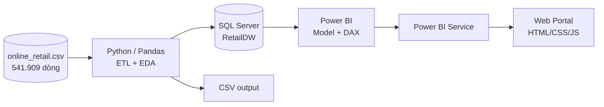
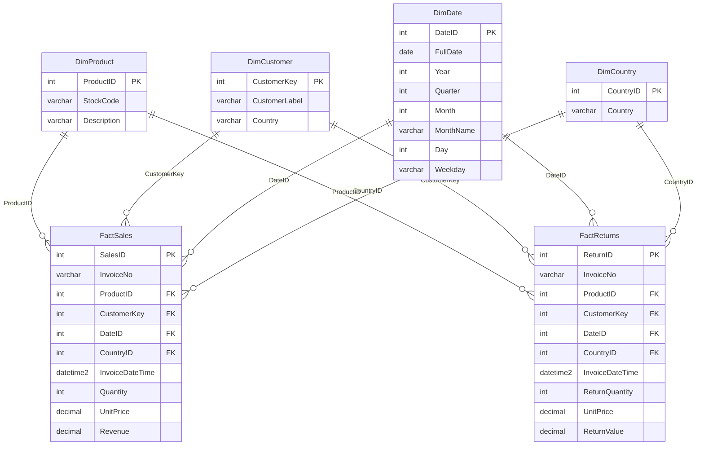

# 🛒 Retail Business Analytics with Power BI

---

## 📌 Giới thiệu

Dự án xây dựng một **hệ thống phân tích kinh doanh end-to-end** cho cửa hàng bán lẻ trực tuyến dựa trên bộ dữ liệu *Online Retail*. Dữ liệu giao dịch thô được làm sạch bằng Python, mô hình hóa thành **Star Schema** trong SQL Server (`RetailDW`), sau đó trực quan hóa bằng **Power BI (DAX)** và tích hợp vào một **Web Portal**.

Đây là đồ án ngành Hệ thống thông tin quản lý:

| | |
|---|---|
| **Đề tài** | Phân tích dữ liệu kinh doanh của cửa hàng bán lẻ sử dụng Power BI |
| **Trường** | Đại học Mở TP.HCM |
| **Sinh viên thực hiện** |Tương Thị Quỳnh Châu – 2354050020 |

## ✨ Tính năng chính

- **Doanh thu & hiệu quả bán hàng**: doanh thu gộp, giá trị hàng trả/hủy, doanh thu thuần, xu hướng theo thời gian.
- **Phân tích khách hàng bằng RFM**: phân khúc khách hàng theo Recency – Frequency – Monetary.
- **Phân tích sản phẩm**: sản phẩm bán chạy, đóng góp doanh thu, trang drill-through *Product Detail*.
- **Phân tích theo thời gian & quốc gia**: mùa vụ, thị trường trọng điểm.
- **Hoạch định tồn kho**: ước tính nhu cầu hàng hóa phục vụ lập kế hoạch nhập hàng.
- **Web Portal**: nhúng báo cáo Power BI Service vào giao diện web.

## 🏗️ Kiến trúc hệ thống



## 🗄️ Mô hình dữ liệu (Star Schema)

Data Warehouse gồm **2 bảng Fact** và **4 bảng Dimension**:



**Các quyết định thiết kế đáng chú ý**

| Vấn đề | Cách xử lý | Lý do |
|---|---|---|
| Giao dịch không có `CustomerID` | Gán `CustomerKey = -1` ("Unknown Customer") | Giữ lại doanh thu thật thay vì xóa dòng |
| Đơn hủy/trả hàng (`InvoiceNo` bắt đầu bằng `C` hoặc `Quantity < 0`) | Tách sang `FactReturns`, lưu số lượng và giá trị dạng **số dương** | Tính được doanh thu thuần và tỷ lệ trả hàng |
| `DimDate` | Sinh **liên tục mọi ngày** trong kỳ dữ liệu | Bắt buộc cho DAX Time Intelligence (`SAMEPERIODLASTYEAR`, `DATEADD`…) |
| `DateID` dạng `YYYYMMDD` | Khóa số nguyên | Join nhanh, dễ lọc trong DAX |
| 1 `StockCode` có nhiều `Description` | Lấy mô tả xuất hiện nhiều nhất | Xử lý lỗi nhập liệu |
| 1 `CustomerID` gắn nhiều quốc gia | Lấy quốc gia xuất hiện nhiều nhất | Đảm bảo 1 khách hàng – 1 quốc gia |

## 🧹 Quy trình ETL

1. **Extract** – đọc `online_retail.csv` (encoding `latin1`).
2. **Transform**
   - Chuẩn hóa kiểu dữ liệu (`InvoiceDate`, `StockCode`, `InvoiceNo`).
   - Đánh dấu đơn hủy/trả hàng.
   - Loại các mã **phi sản phẩm**: `POST, DOT, M, D, BANK CHARGES, CRUK, PADS, C2, AMAZONFEE`.
   - Loại dòng có `UnitPrice <= 0`.
   - Xử lý giá trị thiếu: `CustomerID → -1`, `Description → UNKNOWN PRODUCT`.
   - Tính `Revenue = Quantity × UnitPrice`; dựng các bảng Dim/Fact.
3. **Load** – ghi CSV vào `output/` và nạp SQL Server (Dimension trước, Fact sau để không vi phạm khóa ngoại).

> Script `eda_online_retail.py` khảo sát dữ liệu (giá trị thiếu, bất thường, ma trận tương quan theo sản phẩm) và dùng **cùng quy tắc làm sạch** với ETL.

## 📊 Power BI Dashboard

File: [`powerbi/RetailDashboard.pbix`](powerbi/RetailDashboard.pbix)

| Trang | Nội dung |
|---|---|
| **Overview** | Tổng quan KPI kinh doanh |
| **Sales Performance** | Hiệu quả bán hàng, doanh thu theo các chiều phân tích |
| **Customer Insights** | Phân khúc khách hàng RFM |
| **Geo & Time** | Phân tích theo quốc gia và thời gian |
| **Inventory Planning** | Ước tính nhu cầu, hoạch định tồn kho |
| **Product Detail** | Trang drill-through chi tiết từng sản phẩm |

## 📁 Cấu trúc thư mục

```
retail-bi-powerbi/
├── scripts/
│   ├── etl_online_retail.py   # ETL: CSV → Star Schema → SQL Server
│   └── eda_online_retail.py   # Khảo sát dữ liệu (EDA)
├── sql/
│   └── ddl_star_schema.sql    # Tạo bảng, khóa ngoại, index
├── powerbi/
│   └── RetailDashboard.pbix   # Báo cáo Power BI
└── README.md
```

> Dữ liệu thô `data/online_retail.csv` và thư mục `output/` được tạo trên máy khi chạy, không đưa lên Git (đã khai báo trong `.gitignore`).

## 🚀 Hướng dẫn chạy

### Yêu cầu

- Python 3.10+
- SQL Server (bản Express là đủ) + [ODBC Driver 18 for SQL Server](https://learn.microsoft.com/sql/connect/odbc/download-odbc-driver-for-sql-server)
- Power BI Desktop

### 1. Chuẩn bị môi trường

```bash
git clone https://github.com/<username>/retail-bi-powerbi.git
cd retail-bi-powerbi

python -m venv .venv
source .venv/bin/activate        # Windows: .venv\Scripts\activate
pip install pandas numpy matplotlib sqlalchemy pyodbc
```

### 2. Chuẩn bị dữ liệu

Tải [Online Retail (UCI)](https://archive.ics.uci.edu/dataset/352/online+retail), xuất sang CSV (encoding `latin1`) và lưu thành `data/online_retail.csv` (tạo thư mục `data/` ở thư mục gốc dự án).

### 3. Tạo database và bảng

```sql
CREATE DATABASE RetailDW;
```

Sau đó chạy file [`sql/ddl_star_schema.sql`](sql/ddl_star_schema.sql) trong SQL Server Management Studio.

### 4. Chạy EDA và ETL

Đặt tên SQL Server của bạn qua biến môi trường (mặc định là `localhost`; có thể bỏ qua nếu SQL Server chạy trên chính máy bạn):

```powershell
$env:SQL_SERVER_NAME = "TEN_SERVER"      # Windows PowerShell
# export SQL_SERVER_NAME="TEN_SERVER"    # macOS/Linux
```

Sau đó chạy:

```bash
python scripts/eda_online_retail.py    # (tuỳ chọn) khảo sát dữ liệu, xuất ma trận tương quan
python scripts/etl_online_retail.py    # làm sạch, xuất CSV và nạp vào RetailDW
```

Cuối ETL sẽ in bảng kiểm tra nhanh (doanh thu gộp, giá trị trả hàng, doanh thu thuần, số dòng từng bảng). Có thể đối chiếu với các câu truy vấn kiểm tra ở cuối file DDL.

### 5. Mở báo cáo Power BI

Mở `powerbi/RetailDashboard.pbix` bằng Power BI Desktop → trỏ nguồn dữ liệu tới server `RetailDW` của bạn (*Transform data → Data source settings*) → **Refresh**.

### 6. Web Portal

Mở trang Web Portal để xem báo cáo Power BI được nhúng trong giao diện web.

## 🔮 Hướng phát triển

- Tự động hóa ETL theo lịch (SQL Server Agent / Airflow).
- Chuyển sang nạp tăng dần (incremental load) thay vì nạp lại toàn bộ.
- Bổ sung dự báo doanh thu / nhu cầu bằng mô hình chuỗi thời gian.
- Thiết lập Row-Level Security trên Power BI Service.
- Làm Web bằng Streamlit sẽ hỗ trợ tương tác tốt và thuận tiện hơn.

## 📚 Nguồn dữ liệu

Daqing Chen. *Online Retail* [Dataset]. UCI Machine Learning Repository. https://doi.org/10.24432/C5BW33 (CC BY 4.0).

## 📬 Liên hệ

** Trương Thị Quỳnh Châu** · chautruong232@gmail.com · [GitHub](https://github.com/QuynhChau-png)

